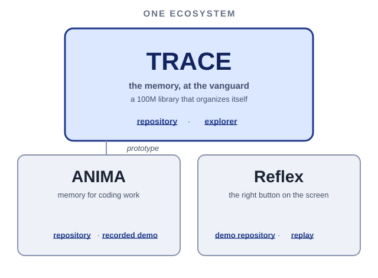

# Anshul Raj — frontier systems lab.

I build memory and tools for developers and researchers whose AI agents keep starting over.

Your agent read the whole repository yesterday. Today it remembers nothing. Ask where the retry logic lives and it searches the world again. Hand it a long task and it drops the thread halfway. Every session starts from zero.

This profile is a map of one ecosystem built to fix that. TRACE is the vanguard: the memory. ANIMA carries that memory into coding work. Reflex takes the same care to the screen.

**[Start with TRACE](https://anshul48.github.io/trace/explorer/)** · [Watch the working films](https://anshul48.github.io/trace/demos/)

## The map

<p align="center">
  <a href="map.svg"></a>
</p>

- **TRACE** — a 100M library that organizes itself. [Repository](https://github.com/Anshul48/trace) · [Explorer](https://anshul48.github.io/trace/explorer/)
- **ANIMA** — a prototype bringing TRACE memory into coding work. [Repository](https://github.com/Anshul48/anima-substrate) · [Recorded demo](https://anshul48.github.io/anima-substrate/demo/)
- **Reflex** — an AI that finds the right button on a screen. [Demo repository](https://github.com/Anshul48/demo-trace-anima-reflex) · [Replay](https://anshul48.github.io/demo-trace-anima-reflex/)

## The 3-minute proof

### TRACE — a memory that organizes itself.

A 100M-token library sorts itself into groups by meaning. A question opens only the groups it needs and scores under one percent of the library.

Built for developers and researchers drowning in documents: the right context at the right time, with a record you can check.

Every answer shows its working: which passages, which groups, what was scored. Pick a recorded question in the explorer, open a result, inspect its source.

[Open the explorer](https://anshul48.github.io/trace/explorer/) — a replay of real recorded searches, nothing to install. [Evidence](https://github.com/Anshul48/trace/tree/main/docs/evidence)

### ANIMA — memory for coding work.

A one-line layer on the coding agent you already use — Muse Code first, with Claude Code and Codex adapters — giving it memory, a checker it cannot see, and a screen to watch it work.

Install it with one line:

```sh
curl -fsSL https://raw.githubusercontent.com/Anshul48/anima-substrate/main/install.sh | sh
```

Its memory is TRACE-backed: past jobs are stored, recalled in front of the next prompt, and re-checked against their source. A real bug-fix run — verified by a hidden checker — replays as a state tree.

[Replay the recorded demo](https://anshul48.github.io/anima-substrate/demo/) — recorded state-tree replay; dashboard shown as UI preview. [How the demo runs](https://github.com/Anshul48/anima-substrate/blob/main/docs/INTEGRATED-DEMO.md)

### Reflex — the right button on the screen.

An AI that looks at a screen and finds the right button to press. Give it a screenshot and a goal in plain words; it points at the control that moves you forward.

In recorded trials on designed screens, Meta's SAM 3.1 marks the controls and Muse Spark chooses the click.

[Watch the replay](https://anshul48.github.io/demo-trace-anima-reflex/) — no login, nothing to install. [Demo repository](https://github.com/Anshul48/demo-trace-anima-reflex)

### Scorecard

| 100M library | 0.79% of the library scored |
|---|---|
| 99.85% of exact top ten kept* | 670 recorded Muse Code worker jobs |

<sub>* 50 test searches; one of four equal library parts; passage-scoring work only.</sub>

### Walkthroughs & Visual Proofs

| Walkthrough | Open |
|---|---|
| Flagship film | [Watch the working films](https://anshul48.github.io/trace/demos/) <!-- VIDEO_SLOT: Flagship film - Replace href when rendered --> |
| 60-second explorer tour | [Open the explorer](https://anshul48.github.io/trace/explorer/) <!-- VIDEO_SLOT: 60-second explorer tour - Replace href when rendered --> |
| ANIMA state-tree replay | [Replay the recorded demo](https://anshul48.github.io/anima-substrate/demo/) <!-- VIDEO_SLOT: ANIMA state-tree replay - Replace href when rendered --> |
| Reflex clip | [Watch the replay](https://anshul48.github.io/demo-trace-anima-reflex/) <!-- VIDEO_SLOT: Reflex clip - Replace href when rendered --> |
| Module deep dives | [TRACE docs](https://github.com/Anshul48/trace/tree/main/docs) · [ANIMA docs](https://github.com/Anshul48/anima-substrate/tree/main/docs) <!-- VIDEO_SLOT: Module deep dives - Replace href when rendered --> |

## Start here

1. [Watch the working films](https://anshul48.github.io/trace/demos/) — the story in three minutes.
2. [Open the TRACE explorer](https://anshul48.github.io/trace/explorer/) — pick a recorded search and inspect its source.
3. [Replay the ANIMA demo](https://anshul48.github.io/anima-substrate/demo/) — a real run as a state tree; dashboard is a UI preview.
4. [Watch the Reflex replay](https://anshul48.github.io/demo-trace-anima-reflex/) — a screen, a goal, the right button.
5. Then the deep end below.

## The deep end

- [Receipts](https://github.com/Anshul48/trace/tree/main/receipts) — the checkable records behind the TRACE numbers.
- [Reproduce](https://github.com/Anshul48/trace/blob/main/docs/REPRO.md) — run the measurements yourself.
- [Architecture](https://github.com/Anshul48/trace/blob/main/docs/ARCHITECTURE.md) — how the memory is built.
- [Research notes](https://github.com/Anshul48/trace/tree/main/docs/vision) — vision and open questions.
- [Status](https://github.com/Anshul48/trace/blob/main/docs/status.json) — current verified state of the build.
- [Contribute](https://github.com/Anshul48/trace/blob/main/CONTRIBUTING.md) — how to help.

<sub>Fine print: the TRACE demo library holds 812,545 passages and 99.9M tokens, short of the 100M target by 0.11%. Scope: 50 test searches; one of four equal library parts; passage-scoring work only. Recorded replays show real past runs; dashboard visuals are UI previews. Reflex is a separate line of work.</sub>
